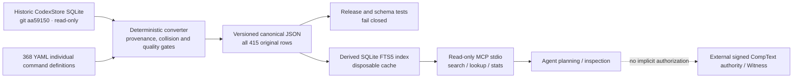

# CompText Codex vNext — Catalog First (isolated research, 22 Nov 2026)

**Status:** verified import and read-only tooling, **not** an executable or human-approved command release. This branch is deliberately isolated from `main`. No Notion connection is needed.

## Architectural choice



**Principle:** One reviewed, versioned canonical JSON catalog is the codebase's desired single source of truth. SQLite is a **rebuildable query index**, not the canonical store. Agents can inspect command definitions; a string such as `CMD:DEPLOY` **cannot execute a tool or approve an action**. Trust and revocation live outside the vocabulary and outside this MCP reader.

## Recovered baseline and crosswalk

- Historical Git commit: `aa59150` (`codex.db`, January 2026), later absent from `main`.
- Source SQLite SHA-256: `b5efb05daa56168939ed097aa0138deafdf919b8c87efd7ea95ef13ac87159ef`.
- SQLite integrity check: `ok`; 18 modules, 415 command records, 2 profiles and 57 archived Notion-derived catalog entries.
- 368 individual YAML definitions are matched exactly by **module, normalized command name, and syntax** against the historical SQLite entries; 0 orphan YAML entries.
- 414 different semantic keys across 415 historic rows. Two rows collide on `J:deploy` (different capitalization/meaning) and are not promoted.
- **334 unreviewed, 81 quarantined, 0 approved/executable.** This is a *quality triage*, not a semantic verification of 334 entries. Placeholder descriptions, collisions, missing syntax and YAML inconsistencies must be resolved before release.
- The 57 historical catalog table rows remain in the original separately preserved DB, not in the active command interface.

Versioned snapshot:
`experiments/vnext/catalog_snapshots/legacy-aa59150-catalog-f51e00d712c9.json`
SHA-256 of canonical catalog body (unkeyed): `f51e00d712c9466e32071872bb2e220194d06d2af080915806e482ad5df41ebc`.
The hash detects accidental changes **only when compared with an externally pinned trusted value**; it is not an Ed25519 signature, hardware witness or human approval.

## Reproduction and usage

Recover the *historical* database to an **isolated private directory**, never to the current project root or a path containing valuable backups:

```bash
mkdir -p /tmp/comptext-codex-import
git show aa59150:codex.db > /tmp/comptext-codex-import/codex.db
python -m experiments.vnext.catalog_cli export \
  --legacy-db /tmp/comptext-codex-import/codex.db \
  --yaml-root codex \
  --out /tmp/comptext-codex-import/catalog.json
python -m experiments.vnext.catalog_cli index \
  --catalog /tmp/comptext-codex-import/catalog.json \
  --out /tmp/comptext-codex-import/index.sqlite
```

The export **does not overwrite** existing output. Input DB and YAML are opened read-only; generated files are separate. Use an isolated Python environment with PyYAML, and (for MCP) MCP 1.x. The legacy project currently allows MCP 2.x despite importing MCP 1.x paths; dependency constraints require independent repair.

Read-only MCP stdio server (after independently reviewing and pinning the snapshot digest):

```bash
export COMPTEXT_CODEX_INDEX_PATH=/tmp/comptext-codex-import/index.sqlite
export COMPTEXT_CODEX_EXPECTED_SHA256=f51e00d712c9466e32071872bb2e220194d06d2af080915806e482ad5df41ebc
python -m experiments.vnext.catalog_mcp_server
```

The MCP server exposes only `catalog_stats`, `catalog_search`, and `catalog_lookup`, and refuses to operate without a valid pinned hash and index. It does not expose file mutation, approval, revocation, shell execution, arbitrary SQL, or old Notion API endpoints. FTS5 is lexical, not semantic: false negatives on natural-language paraphrases are expected and **must not be represented as a model-quality success**.

## Verified tests and boundaries

- Focused catalog, derived-index and real MCP-stdio integration tests: **16 passed**.
- Full legacy + vNext Python test suite in isolated Python environment (MCP 1.30.0): **384 passed**, 1 pytest-asyncio deprecation warning (not a failure).
- Historical private DB: `/home/sprite/comptext-codex-recovered-20261122/codex-415-commands-aa59150.db`; separate candidate snapshot and derived index exist on Sprite and were tested.
- Unknown commands, missing sources, ambiguous keys, external SHA mismatch, malformed schema and SQL-injection-shaped search input fail closed or return no executable command.
- No existing `main`, Cloudflare witness, CompText trust approvals, or Windows PC data was modified by the catalog tooling.

## Next gates (not yet implemented)

1. **Editorial quality gate:** replace 78+ generic auto-extracted placeholders with independently reviewed definitions, resolve `J:deploy`, add examples and negative tests. Track review decisions in Git, never grant approval merely by changing a `quality` string.
2. **Schema/semver gate:** JSON Schema 2020-12 contracts and compatibility tests for every command signature, aliases, and module.
3. **Runtime handoff:** link the versioned command ID and exact catalog digest to the CompText lossless vNext message envelope; runtime authorization remains independently signed and revocation-aware.
4. **Search evaluation:** FTS5 first, then hybrid retrieval only with same-budget, semantic, adversarial and abstention tests. Don't invent an FHRR performance advantage.
5. **GitHub CI and signed release provenance:** full-suite tests plus import re-generation check; independent signing identity and remote witness remain future security prerequisites.

Official references: [MCP 2026-07-28 tools specification](https://modelcontextprotocol.io/specification/2026-07-28/server/tools), [JSON Schema Draft 2020-12](https://json-schema.org/draft/2020-12/), [SQLite Backup API](https://sqlite.org/backup.html).

**Audit note:** This is a code-reviewable research prototype. Never infer production readiness, cryptographic authority, or human approval from the fact that tests pass.
